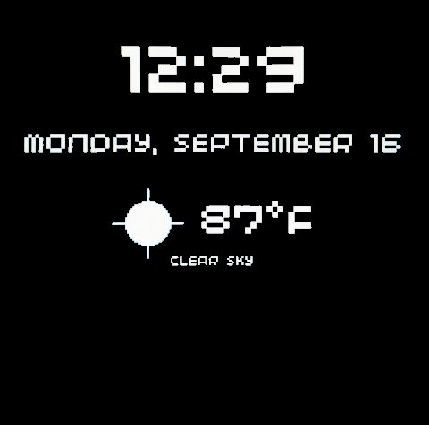

# Presto Weather Clock

A nightstand digital clock and weather display for the
[Pimoroni Presto](https://shop.pimoroni.com/products/presto) - a
RP2350-powered, 4" touchscreen display. It shows the current time and
live conditions from [OpenWeatherMap](https://openweathermap.org/), and
automatically dims itself at night so it isn't dazzling on a bedside
table.



## Features

- Large, centred digital clock (12h or 24h, with or without seconds).
- Current weather from OpenWeatherMap: temperature, condition and a
  simple hand-drawn icon (sun, cloud, rain, snow, storm, mist) - no
  image assets or extra fonts required.
- Automatic nightstand dimming on a configurable schedule.
- Tap the screen at any time to force an immediate weather refresh.
- Resilient by design: if Wi-Fi, NTP or the weather API misbehave, the
  clock keeps running and shows the last known-good weather instead of
  crashing or freezing.

## Hardware

- [Pimoroni Presto](https://shop.pimoroni.com/products/presto)
- The latest [Presto MicroPython firmware](https://github.com/pimoroni/presto/releases/latest)
  flashed to the board (see [Getting Started with Presto](https://learn.pimoroni.com/article/getting-started-with-presto))

## Project layout

| File | Purpose |
| --- | --- |
| `main.py` | Entry point: connects to Wi-Fi, syncs time, and runs the main draw loop. |
| `config.py` | Non-secret settings (location, units, dimming schedule, etc). Safe to commit. |
| `secrets.example.py` | Template for `secrets.py` - Wi-Fi credentials, API key, UTC offset. |
| `timeutil.py` | Time/date formatting and the day/night window calculation. |
| `weather.py` | Minimal OpenWeatherMap "current weather" client. |
| `weather_icons.py` | Draws weather icons from basic shapes (no image files needed). |
| `display_ui.py` | Lays out and draws the clock + weather screen. |
| `tests/` | Host-run unit tests (see [Development](#development)) for the pure-Python logic. |

## Setup

1. **Get an OpenWeatherMap API key.** Sign up for a free account at
   <https://openweathermap.org/api> and copy your API key.

2. **Copy the secrets template** and fill in your details:

   ```sh
   cp secrets.example.py secrets.py
   ```

   ```python
   WIFI_SSID = "your-network-name"
   WIFI_PASSWORD = "your-network-password"
   OPENWEATHER_API_KEY = "your-openweathermap-api-key"
   UTC_OFFSET = 0  # e.g. -5 for New York, 1 for Paris
   ```

   `secrets.py` is listed in `.gitignore` and is never committed.

3. **Edit `config.py`** to taste - at minimum set your `LOCATION`:

   ```python
   LOCATION = {"city": "London,GB"}
   # or, for better accuracy in small towns:
   # LOCATION = {"lat": 51.5072, "lon": -0.1276}
   ```

   See the comments in `config.py` for the full set of options
   (12h/24h clock, seconds, units, update interval, resolution, ambient
   LEDs, and the night-dimming schedule).

4. **Copy the project to your Presto.** With the board connected and
   running the Presto firmware, use [Thonny](https://thonny.org/) (or
   `mpremote`/`rshell`) to upload every `.py` file in this repository
   to the root of the board's filesystem, so it ends up looking like:

   ```
   /main.py
   /config.py
   /secrets.py
   /timeutil.py
   /weather.py
   /weather_icons.py
   /display_ui.py
   ```

5. **Reset the board.** Presto automatically runs `main.py` on boot, so
   it will connect to Wi-Fi, sync the time and start showing the clock.

## Configuration reference

### `secrets.py` (not committed)

| Setting | Description |
| --- | --- |
| `WIFI_SSID` / `WIFI_PASSWORD` | Your wireless network credentials. |
| `OPENWEATHER_API_KEY` | Your free OpenWeatherMap API key. |
| `UTC_OFFSET` | Hours offset from UTC. MicroPython has no timezone database, so there's no automatic DST - update this by hand when your clocks change. |

### `config.py` (committed, safe to share)

| Setting | Default | Description |
| --- | --- | --- |
| `LOCATION` | `{"city": "London,GB"}` | City name (`"City,CC"`) or `{"lat":.., "lon":..}` coordinates. |
| `UNITS` | `"metric"` | `"metric"` (°C) or `"imperial"` (°F). |
| `USE_24_HOUR_CLOCK` | `True` | 24-hour vs 12-hour clock display. |
| `SHOW_SECONDS` | `False` | Show `HH:MM:SS` instead of `HH:MM`. |
| `WEATHER_UPDATE_INTERVAL_MINUTES` | `10` | How often to poll OpenWeatherMap. |
| `FULL_RES` | `False` | `True` for crisp 480x480 rendering (slower to redraw). |
| `AMBIENT_LIGHT` | `True` | Mirror the screen colours on Presto's onboard RGB LEDs. |
| `NIGHT_DIMMING_ENABLED` | `True` | Automatically dim the backlight overnight. |
| `NIGHT_START_HOUR` / `NIGHT_END_HOUR` | `22` / `7` | Local-time (24h) window during which the screen is dimmed. |
| `DAY_BRIGHTNESS` / `NIGHT_BRIGHTNESS` | `1.0` / `0.05` | Backlight levels (`0.0`-`1.0`) outside/inside the night window. |

> **Note on `AMBIENT_LIGHT` vs. night dimming:** these are two independent
> hardware features. `NIGHT_DIMMING_ENABLED` only changes the LCD panel's
> backlight (via `presto.set_backlight()`); it never touches the onboard
> RGB LEDs. When `AMBIENT_LIGHT` is `True`, those LEDs are driven entirely
> by Presto's own firmware, which mirrors the colours already on screen -
> so they can appear to dim or change on their own, independently of the
> backlight brightness setting above. Also note that Presto's backlight PWM
> curve is very non-linear: only `1.0` is true full brightness, and most
> other values collapse onto a narrow, barely-distinguishable low range, so
> `NIGHT_BRIGHTNESS` needs to be quite low (e.g. `0.05`) to look visibly
> dimmer than daytime.

## How it works

- `main.py` connects to Wi-Fi using Presto's built-in `secrets.py`
  convention, syncs the clock over NTP, then loops forever: it polls
  touch, refreshes the weather on a timer (or immediately on tap),
  adjusts the backlight for day/night, and redraws the screen.
- Weather fetch failures (bad Wi-Fi, API downtime, quota limits, etc.)
  are caught and remembered as a message rather than raised, so the
  clock keeps ticking and simply shows the last successful reading
  with a small "showing last known reading" note.
- Weather icons are drawn from circles, rectangles and lines rather
  than bundled image files, so there's nothing extra to upload or that
  can go missing from the filesystem.

## Development

The hardware-specific modules (`presto`, `ntptime`, the Presto build of
`requests`) only exist on-device, but the pure logic - time formatting,
the day/night window, the OpenWeatherMap client and the screen layout -
is written so it can also run under regular CPython and be unit
tested on your computer:

```sh
python -m unittest discover -s tests -v
```

Tests use `unittest.mock` to stand in for the network, and small fake
"display" objects to stand in for PicoGraphics, so no hardware or
network access is required.

## License

MIT - see [LICENSE](LICENSE).
